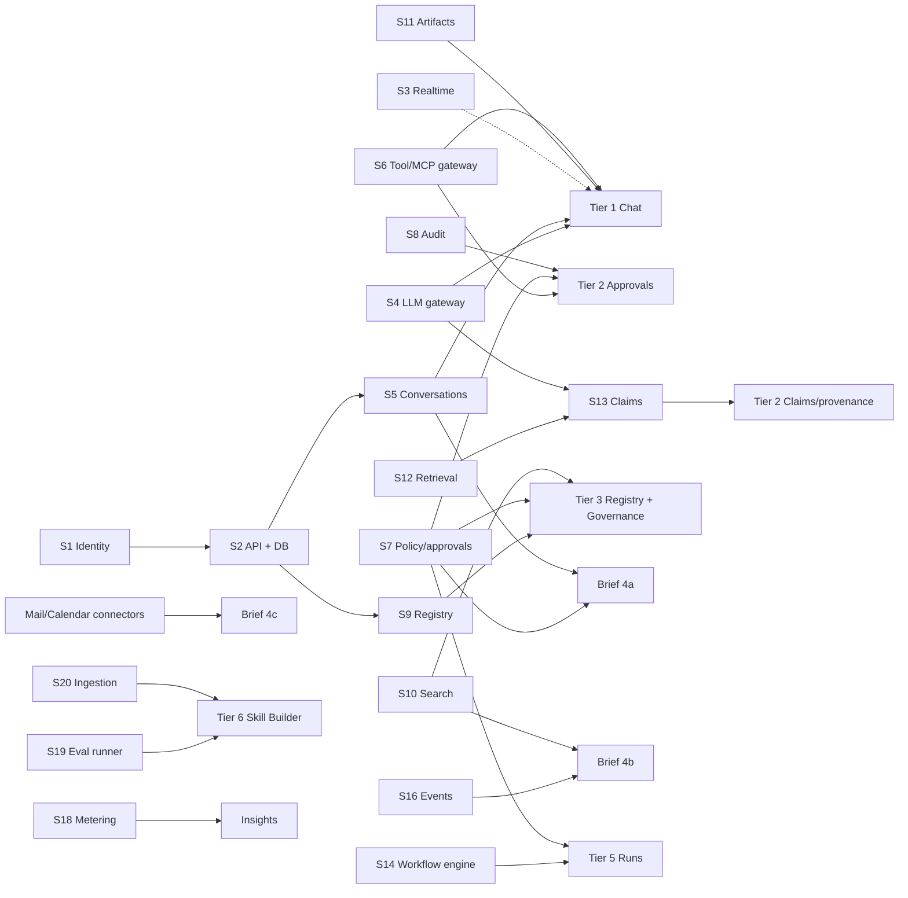

# Donovan: Implementation Plan

Source design: `Donovan.dc.html` plus its data files (`donovan-data.js`, `donovan-data-2.js`, `donovan-threads.js`, `donovan-brief.js`) and the three embedded flows (`Register Wizard`, `Skill Builder`, `Model Studio`). Intent comes from `chats/chat1-3.md`.

This is a plan only. It ranks features and maps each one to the backend and supporting services it depends on, so it's clear which features are **blocked** until a service exists and which can ship on mocks or a reduced fallback.

---

## 0. Quarterly roadmap

**How to read it.**
- Front-end rows list the features **released to users** in each quarter.
- Backend rows list the services that become **ready** in each quarter. Every feature ships at least one quarter after all the services it depends on are ready.
- Decisions and approvals that must start now are not on the roadmap. They are listed in §4 (long-lead items) and §5.
- Service IDs (S#) are defined in §2.

**Assumptions.**
- Work starts November 2026, and nothing ships or becomes ready before Q1 '27.
- Quarters are calendar quarters.
- There is one team per workstream (§4).
- This shows order and dependencies, not committed dates.

| | Q1 '27 | Q2 '27 | Q3 '27 | Q4 '27 | 2028 |
|---|---|---|---|---|---|
| **Assist** | • App shell, nav rail, Assist/Build toggle, theme, routing • ⌘K palette (local results) | • Sign-in + chat: streaming, rich blocks, history, pins • Message actions, outline + bookmarks • Context meter, persona, knowledge toggle • Projects | • Artifact pane + Artifacts page • Auto / Manual routing • Tool calls + write approval panel • Session panel: intent / Calibrated, Artifacts, Metadata | • Sources tab + "Workspace docs" knowledge • Claim markers + confirm / dispute • ⌘K global search | • Export with provenance |
| **Daily Brief** | — | — | • Brief page + auto-open at sign-in • Needs you (approvals, review queue) • Pick up where you left off • Ask about your brief | • "Donovan's read" summary • Changed-since-yesterday rings | • New search results • Paused workflows in Needs you • New memos • Today calendar |
| **Build** | — | — | • Catalog pages for 9 areas, detail pages, org pages, collections • Use / Run / Insert in chat • Install modal • Governance: Policies + Tiers | • Register wizard + Governance queue • Try drawer • Insights + usage stats • Workflow canvas + editor • New workflow from description • Skill Builder: Ingest → Draft | • Workflow runs + approval node • Skill Builder: Test / Score / Publish; model Evals tab • Spaces demos • Model Studio (on-device) • Notifications bell |
| **Backend: Platform** | • S1 Identity & org directory • S2 API gateway + database • S3 Realtime transport • S5 Conversation store | • S11 Artifact store • S20 Ingestion | — | — | — |
| **Backend: AI core** | • S4 LLM gateway (inference, streaming, token counts) | • S4 Auto routing | • S12 Retrieval / knowledge • S13 Claims | • S13 Provenance export • S19 Eval runner • S22 Model serving | • S21 Training platform (only if Studio training is server-side; this pushes Studio past 2028) |
| **Backend: Tools & governance** | — | • S6 Tool / MCP gateway + credential vault • S7 Policy & approval engine • S8 Audit log • S9 Registry (read, versions, ownership) | • S6 Sandbox mode • S9 Registry write + moderation | — | — |
| **Backend: Data & integrations** | — | • S15 Brief aggregator (internal sources) | • S10 Search index • S15 Brief LLM summary • S16 Activity / event bus • S18 Usage metering | • S10 Saved searches • S14 Workflow engine • S15 Mail + calendar connectors • S17 Notifications | — |

---

## 1. What the prototype fakes today

Everything in the design is client-side state and canned data. To find what the backend must provide, list what the prototype simulates:

| Prototype behavior | What it fakes | Real dependency |
|---|---|---|
| `send()` appends `D.canned` instantly | LLM response, routing, streaming | LLM gateway + router, conversation store, realtime transport |
| "Worked for 4.2s · 2 tool calls", tool durations | Execution telemetry | Tool runtime emitting timings |
| Tool cards `done/pending`, Approve/Deny flips local flags | Tool execution, write-gating, approval decisions | MCP/tool gateway, policy and approval engine |
| Claims (GRND/MODEL/INFER, confidence, source passages) | Claim extraction and grounding | Retrieval/knowledge service, claims and provenance service |
| Context meter, session manifest, prompt hash | Token accounting, reproducibility metadata | LLM gateway token counts, session manifest store |
| Export with provenance (toast only) | Export pipeline | Provenance/export service, artifact store |
| Artifact pane bodies from `D.artifactBodies` | Generated docs/code/data | Artifact store with versioning and renderers |
| Daily Brief (`DONOVAN_BRIEF`) | Memos, calendar, saved-search hits, activity rings, "Donovan's read" | Brief aggregator, external connectors, search, activity feed, LLM summarization |
| Mine/Team/All via `D.owners` | Ownership and team membership | Identity/org directory, registry ownership |
| Catalog cards for 9 entity types | Registry contents, versions, stats | Registry/catalog service, usage metering |
| Register Wizard → `submitted[]` → Governance queue | Registration and moderation | Registry write API, moderation workflow, policy engine |
| Try drawer `mockResult` | Sandboxed tool execution | MCP gateway sandbox mode |
| Install modal snippet | Client config and CLI | Gateway endpoint per server, `donovan` CLI (optional) |
| Workflow run: `setInterval` over `D.stages` | Durable orchestration, pause at approval | Workflow engine, policy engine, tool runtime |
| Workflow edit/Save & publish | Graph persistence and validation | Workflow definition store (validation can be client-side) |
| Skill Builder analyze/test/score | Ingestion, synthesis, eval runs | LLM gateway, file/URL ingestion, eval runner, registry |
| Model Studio training loss curve | Training jobs | Training platform, or client-side on-device training (design says "on-device · Web Worker") |
| Space "Run" (900 ms) | Hosted model demo | Inference serving for registered models |
| Insights KPIs and "calls by model" | Usage and cost analytics | Metering pipeline and analytics store |
| ⌘K palette (substring over local data) | Global search | Search index across chats and registry |
| Toasts for Mail/Teams/app picker | Cross-app links | App directory / launcher config, deep-link URLs |

---

## 2. Backend and supporting services

Each service has an ID used in the matrix below. Sizes are relative effort (S/M/L/XL), not time estimates.

| ID | Service | Responsibilities | Size | Notes |
|---|---|---|---|---|
| **S1** | Identity & org directory | SSO/OIDC login, user profile, teams, orgs, roles (approver groups), "last login" timestamp | M | Usually exists in the enterprise; integrate rather than build. Blocks nearly everything multi-user. |
| **S2** | API gateway / BFF + primary DB | REST/GraphQL surface for the web app, persistence, authz checks | M | Foundation for every feature that stores anything. |
| **S3** | Realtime transport | SSE/WebSocket for token streaming, tool status, workflow run state, notifications | S | Needed for the live feel; polling is a degraded fallback. |
| **S4** | LLM gateway & router | Multi-model inference, streaming, token counts, Auto routing (pick model/skill/tools), Manual overrides, persona/temperature params | L | The critical-path service for chat. |
| **S5** | Conversation store | Chats, messages, typed blocks, pins, bookmarks, feedback, regenerated versions, projects, project settings (Calibrated) | M | Schema can follow the prototype's block model (text, list, tool, skill, table, code, artifact, chart, steps, workflow, claims). |
| **S6** | Tool / MCP gateway | Register and connect MCP servers, credential vault (OAuth 2.1/API key/service account), execute tools, sandbox mode for Try, per-call telemetry | L | Prototype references `gateway.donovan.internal/{slug}`. Build vs buy decision needed. |
| **S7** | Policy & approval engine | Sensitivity tiers (Public < Internal < Confidential < Restricted), policies (toggles), write-gating, approval requests and decisions, approver routing, "always in this chat" grants | L | Shared by chat tool calls, workflow approval nodes, registration moderation. |
| **S8** | Audit log | Immutable record of tool calls, approvals, policy changes, exports | S–M | Required by "Audit every call" toggle and governance credibility. |
| **S9** | Registry / catalog | CRUD and versioning for skills, MCP servers, tools, agents, APIs, models, datasets, spaces, collections, prompts; ownership; orgs; stats; collection tier ceiling; moderation queue state | L | Backbone of Build mode. |
| **S10** | Search index | ⌘K global search across chats + registry; saved searches with "new since" hit counts | M | Saved searches also feed the Brief. |
| **S11** | Artifact store | Blob storage, versions, renderers for Doc/Code/Data, sensitivity labels, "Save" | M | |
| **S12** | Retrieval / knowledge | Workspace document corpus, chunking, retrieval with passages + match strength, "Live" web source, "Training only" mode | L | Needed for Grounded claims and the Sources tab. |
| **S13** | Claims & provenance | Extract claims from answers, classify grounded/model/inferred, confidence, link to passages, verification status (confirm/dispute), session manifest, prompt hash, export with provenance | L | Depends on S4 + S12. Novel; highest research risk. |
| **S14** | Workflow engine | Durable execution of node graphs (Trigger/Tool/Model/Skill/Approval/Branch), pause/resume on approval, retries/on-failure, run log streaming, definition storage + versioning | L–XL | Buy/adopt (Temporal, etc.) strongly recommended. |
| **S15** | Brief aggregator + connectors | "Since last login" digest: needs-you (from S7 approvals, S14 paused runs, S9 queue), memos (mail connector), calendar connector, saved-search hits (S10), activity rings (event feed), LLM-written summary | L | External connectors (mail, calendar, Teams, ServiceNow) are the long pole. |
| **S16** | Activity / event bus | Domain events (model published, workflow paused, dataset updated, person activity) consumed by Brief rings, notifications, Insights | M | |
| **S17** | Notifications | Bell icon feed, unread state | S | Not designed beyond a bell + dot; low priority. |
| **S18** | Usage metering & analytics | Calls, cost, routing share per model, KPIs with deltas | M | Fed by S4 and S6 telemetry. |
| **S19** | Eval runner | Run test cases against skills/models, scores vs previous version | M | Skill Builder Test/Score, model Evals tab. |
| **S20** | Ingestion | File upload, URL fetch, text extraction for Skill Builder sources and Studio data | M | |
| **S21** | Training platform | Classifier and LM training jobs, metrics streaming, versions, publish to registry | XL | Can be replaced by client-side training if the "on-device" design holds. |
| **S22** | Model serving for Spaces | Run hosted demos against registered models | M | |

---

## 3. Feature priorities and blockers

Legend: **B** = blocker (feature can't function without it) · **D** = degrades (ship with a mock/fallback, feature still useful) · blank = not needed.

### Tier 0: Foundation (no backend blockers)

Can start immediately against a typed mock API (e.g. MSW) built from the prototype's data shapes.

| Feature | Notes |
|---|---|
| Design system: IMIN tokens (light + dark), Inter, type scale, badges, segmented controls, toggles, toasts | Unify badge styles now (UX review #18) rather than port three variants. |
| App shell: top bar, Assist/Build toggle, rail (248/60 px, auto-collapse < 1280 px), app picker, theme toggle | App picker targets come from config. |
| Routing (URL per area/view; see §6) | Prototype has none; replaces `go(mode, area, extra)`. |
| Shared catalog page component (scope toggle, card/list toggle, primary action, filter chips, card + list row) | Used by 9 areas. |
| Command palette shell | Local filtering first; S10 later. |
| API contract (OpenAPI/GraphQL schema) for every entity + chat block types | Unblocks parallel frontend/backend work. **This is the most important Tier 0 deliverable.** |

### Tier 1: Core chat (MVP)

The chat is the product's center; ship first.

| Feature | S1 | S2 | S3 | S4 | S5 | S6 | S7 | S11 | Other |
|---|---|---|---|---|---|---|---|---|---|
| Sign-in, greeting, avatar | B | B | | | | | | | |
| Chat home + composer, send, streaming reply | B | B | D | **B** | B | | | | |
| Chat history in rail (Pinned/Today/Yesterday/Earlier), pin | B | B | | | B | | | | |
| Auto/Manual routing chips | | | | B | | D | | | S9 D for skill/server pick lists |
| Rich blocks: text, list, table, code, chart, steps | | | | B | B | | | | Rendering is frontend-only |
| Tool call cards (read-only tools) | | | D | B | B | **B** | | | |
| Message actions: copy, regenerate + versions, thumbs + reason | | | | B | B | | | | Feedback store |
| Artifact cards + right artifact pane | | | | B | B | | | **B** | |
| Floating left outline + bookmarks | | | | | B | | | | Frontend + bookmark persistence |
| Context window meter/popover | | | | B | | | | | Needs per-turn token breakdown from S4 |
| Persona / knowledge source toggles | | | | B | B | | | | Knowledge = "Workspace docs" needs S12 (Tier 2) |

**Critical path: S1 → S2 → S4 → S5.** Without S4, there is no product; it is the first backend investment.

### Tier 2: Trust and governance in chat

What separates Donovan from a generic chat; required before writes are allowed or Confidential data is used.

| Feature | S4 | S6 | S7 | S8 | S12 | S13 | Other |
|---|---|---|---|---|---|---|---|
| Write tools gated as "Needs approval" + Review ⏎ | | B | **B** | B | | | |
| Approval side panel (reason, tier, policy, approvers, params; Approve once / Always in this chat / Deny) | | B | **B** | B | | | S1 B for approver groups |
| Sensitivity chips on chats/tools/artifacts (`showGovernance`) | | | B | | | | Tier labels on S5/S9 entities |
| Session fly-out: Sources tab | | D | | | **B** | D | |
| Inline claim markers + Claims list, confirm/dispute | B | | | | **B** | **B** | |
| Session intent + verification checkpoint (Calibrated projects) | B | | | | | D | S5 project setting |
| Metadata tab: project, sensitivity, mode, routing, context, manifest | B | | | | | B | Manifest/prompt hash persisted per session |
| Export with provenance | | | | B | | **B** | S11 for export file |

**Recommendation:** ship approvals (S6 + S7 + S8) before claims (S12 + S13). Approvals are a hard safety requirement for write tools; claims are a differentiator with research risk. Claims UI can ship behind a flag with the "AI-generated claims can be wrong" disclaimer.

### Tier 3: Build-mode registry (browse, detail, register, govern)

| Feature | S1 | S6 | S7 | S9 | S10 | S18 | Other |
|---|---|---|---|---|---|---|---|
| Catalog pages (9 areas), Mine/Team/All scope, card/list | B | | | **B** | | D (stats) | |
| Detail pages: MCP server (tools, params, spec), agent, dataset (schema, load snippet), model (Card/Use/Files/Evals), collection (tier ceiling), org page | | D | | **B** | | D | S19 D for Evals; S11 for model files |
| "Use in chat" / "Run in chat" / "Insert in chat" | | | | B | | | Requires Tier 1 |
| Try drawer (sandboxed tool run) | | **B** | B | B | | | |
| Install modal (client config snippet) | | B | | B | | | Static template once gateway URLs exist |
| Register wizard (9 types, Type → Identity → type-specific → Governance → Review) | B | D (server/tool connectivity check) | B | **B** | | | |
| Governance: Queue (approve/request changes/reject), Policies (toggles), Tiers | B | | **B** | **B** | | | S8 B |
| ⌘K global search | | | | B | **B** | | Covers chats (S5) too |
| Space detail demo | | | | B | | | S22 B |
| Prompts library | | | | B | | | Prompt editor not designed (open item) |

**Recommendation:** ship read-only browse/detail and Governance Queue first, then Register, then Try/Install. Browse needs only S9; Try needs the full S6 sandbox.

### Tier 4: Daily Brief

Designed as the sign-in landing page, but it depends on the most services. Ship it incrementally, starting with internal sources.

| Brief section | Dependencies | Phase |
|---|---|---|
| Header, "since" timestamp | S1 (last login) | 4a |
| Needs you (approvals, paused workflows, sign-offs, access requests) + deep links | S7, S9 queue, S14 (paused runs) | 4a (approvals/queue only); add workflows when S14 exists |
| Pick up where you left off | S5 | 4a |
| Changed-since-yesterday rings (people/projects/models/flows/datasets) | **S16** event feed, S9, S5 | 4b |
| New search results | **S10** saved searches with "new since" | 4b |
| "Donovan's read on your queue" summary | S4 over the aggregated digest | 4b |
| New memos (Draft reply, Open in Mail) | **External mail connector** + S4 for drafting | 4c |
| Today (calendar) | **External calendar connector** | 4c |
| Ask about your brief | S4 + Tier 1 chat | 4a |
| Auto-open at sign-in | S1 + user preference in S2 | 4a |

**Blocker summary:** 4c is blocked on enterprise connectors (mail, calendar; the design also links to Teams and ServiceNow) and their data-access approvals. These need security/legal review, so **start that process now** even though the feature is Tier 4. Until 4a ships, the app lands on Chats.

### Tier 5: Workflows

| Feature | Dependencies |
|---|---|
| Workflow catalog + canvas view (static graph) | S9 / workflow definition store |
| Edit mode: palette, drag, inspector, connect/delete, on-failure, tier, checks, Save & publish | Definition store (S2); bind-option lists from S9 (tools/models/skills) and S1 (approver groups). Validation can run client-side, but must also run server-side on publish. |
| New workflow: "describe it, Donovan drafts the steps" | S4 |
| Run now: live node states, animated edges, run log | **S14** + S3 |
| Approval node pause/resume | **S14 + S7** |
| Workflow status card in chat | S14 + Tier 1 |

The canvas editor is mostly frontend work and can be built in parallel. Runs are blocked on S14. Note that the prototype shares one graph across all workflows; the real model needs per-workflow, versioned definitions.

### Tier 6: Skill Builder

| Step | Dependencies |
|---|---|
| Ingest (paste / upload / URL) + summary | S20 (upload, URL fetch), S4 (summary/topics) |
| Synthesize (principles, models, heuristics, gotchas, criteria) | S4 |
| Strategy, Draft (SKILL.md editor + preview) | Frontend; S4 for "Generate draft" |
| Test (cases, run all) | **S19** + S4 |
| Score (vs previous version) | S19 + S9 version history |
| Package / Publish / Submit to registry | S9, S7 (moderation queue) |

### Tier 7: Model Studio and Insights

| Feature | Dependencies |
|---|---|
| Studio: labels, data, review queue, train, evaluate (classifier); corpus, train, samples, versions (LM) | **S21**, unless training runs client-side as the design states ("on-device · Web Worker · CPU only"). In that case only S20 (data) + S9 (publish) are blockers. |
| Publish model from Studio | S9 + S7 moderation |
| Insights: KPIs, calls by model, cost | **S18** (fed by S4/S6 telemetry) |
| Notifications bell | S17 + S16 (not designed beyond an icon) |

---

## 4. Critical path and sequencing

Suggested workstreams that can run in parallel:

1. **Frontend:** Tier 0, then each tier's UI against mocks, ahead of the backend. The workflow canvas editor, Skill Builder screens and catalog pages carry little backend risk.
2. **Platform:** S1, S2, S3, S5, then S11.
3. **AI core:** S4 first, then S12 → S13 (start the claims research spike early; it has the highest uncertainty).
4. **Tools and governance:** S6 + S7 + S8 together (they're tightly coupled), then S9.
5. **Long-lead items to start now:** enterprise connector approvals (mail/calendar), workflow-engine build-vs-buy decision, MCP gateway build-vs-buy, and whether Model Studio training is really on-device.

---

## 5. Decisions needed before implementation

1. **Frontend stack.** The repo has no app code. Recommendation: React + TypeScript (Vite or Next.js); the prototype is already React-based under its template runtime.
2. **Build vs buy:** LLM gateway (S4), MCP gateway (S6), workflow engine (S14), search (S10).
3. **Model Studio training location:** on-device (as designed) vs server-side (S21, XL). This moves the feature from blocked to unblocked.
4. **Which external connectors** feed the Brief (mail, calendar, Teams, ServiceNow) and the data-access approvals for each.
5. **Dark theme:** the IMIN guide doesn't define one; the prototype's is extrapolated with contrast issues (UX review #19). Brand to define it, or drop the toggle.
6. **Logo:** placeholder star; need the real IMIN SVG (UX review #20).
7. **Claims scope for v1:** full extraction/grounding, or ship the UI for grounded citations only and defer model/inferred classification.
8. **Approval semantics:** who approves in-chat writes (the user themselves vs a named group), how long "Always in this chat" lasts, and whether approvals are synchronous in-chat or can arrive asynchronously (the Brief's "Needs you" implies async).

---

## 6. Prototype gaps to resolve during the port

Things not to copy literally:

- **Routing:** none in the prototype. Proposed routes: `/assist/brief`, `/assist/chats/:id`, `/assist/projects/:id`, `/assist/artifacts?kind=`, `/build/{skills|servers|agents|workflows|models|datasets|spaces|collections|prompts}/:id?tab=`, `/build/skills/:id/builder?step=`, `/build/workflows/:id/edit`, `/build/governance?tab=`, `?scope=mine|team|all`.
- **Dead code:** the old context panel (template lines 133–284, `panelDisplay:'none'`), the dedicated Skills/Models/Collections list views (overridden at line 1988), the inline skill-builder logic, and claim margin markers/pane claim tabs that are computed but never rendered. Don't port these.
- **Hardcoded values:** the "today" date, the "Before 2:00 PM" pill, the approval toast text, the "SKU 88213-BLK" run toast, `publishSkill` v1.5, and the Governance KPIs "8 published" / "2.1h". All of these become data.
- **Global workflow graph:** `wfNodes`/`wfEdges` are shared across workflows; they must be per-workflow and versioned.
- **Controls that do nothing yet:** Attach, notifications bell, avatar menu, code-block Copy, model file Download, dataset Download, Skill Builder Upload/URL tabs, Studio swatch recolor, number-key labeling, Restore, Export, New project, Upload artifact, prompt editor, ⇧⌘B shortcut. Each needs a decision: build it or remove it.
- **Brief preference:** `briefAuto` isn't read at mount; make "open at sign-in" a persisted user setting.
- **Listener leaks / load-order polling:** artifacts of the prototype runtime; a normal app with data fetching won't need them.
- **UX review items still open:** collapse control label (#6), shared composer between home and thread (#9), outline hover clarity (#10), agent stat tile holding text (#17), badge unification (#18), dark theme (#19), logo (#20), 11 px text in the embedded flows' rails (#21), and the three flows (Register / Skill Builder / Studio) still using different shells (#16). Fold these into Tier 0 design-system work rather than porting the inconsistencies.

---

## 7. Summary: what's blocked by what

| If this service doesn't exist… | …these features are blocked |
|---|---|
| S4 LLM gateway | All chat, Brief summary, workflow drafting, Skill Builder synthesis, claims |
| S1 Identity | Sign-in, Mine/Team/All scope, approver routing, Brief "since last login" |
| S5 Conversation store | Chat history, pins, bookmarks, projects, "Pick up where you left off" |
| S6 Tool/MCP gateway | Tool calls in chat, Try drawer, Install, workflow tool steps |
| S7 Policy/approvals | Write tools, approval panel, Governance, workflow approval nodes, Brief "Needs you" |
| S9 Registry | All of Build mode, Register, Use-in-chat pick lists, Collections tier ceiling |
| S12 + S13 Retrieval + claims | Grounded claims, Sources tab, verification, export with provenance |
| S14 Workflow engine | Workflow runs, paused-run items in Brief, workflow card in chat |
| S15 + connectors | Brief memos and calendar |
| S10 Search | ⌘K beyond local data, Brief search results |
| S16 Events | Brief rings, notifications |
| S18 Metering | Insights, catalog usage stats |
| S19 Eval runner | Skill Builder Test/Score, model Evals |
| S21 Training (if server-side) | Model Studio |
| S22 Serving | Space demos |
